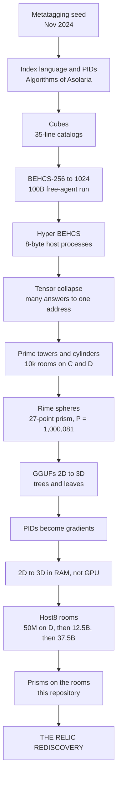

# Lineage: from the Algorithms of Asolaria to the Relic Rediscovery

This benchmark is one step in a longer line of work by Jesse Daniel Brown. Each stage below says
what it was, when it happened and where its record lives. The order follows Jesse's own account:
the creation lineage he gave on 2026-06-16 (stages 1–6, recorded in
[`what-is-asolaria`](https://github.com/JesseBrown1980/what-is-asolaria---how-do-we-get-reductions-in-everything),
`ASOLARIA-CREATION-LINEAGE-AND-SUPERVISORS.md`), continued with the stages that followed. The hand-drawn flipchart sheets where the system was
first laid out are transcribed in [`ORIGINS.md`](ORIGINS.md).

## 1. The seed: metatagging a quantum universe (November 2024)

[Metatagging-data-for-a-Quantum-universe](https://github.com/JesseBrown1980/Metatagging-data-for-a-Quantum-universe)
tags simulated quantum entities with 3D vector metadata. It is the first public form of the
time, space, colour and energy coordinates that run through everything after it.

## 2. The Index language and the Algorithms of Asolaria

- **The sequence:** Asolaria → Falcon → Codex → the **Index language**.
- **The Index language** was the first compression catalog, reaching 12:1. Each row carried an
  agent's PID, device, name, tools, skills, abilities, mistakes, hookwalls, hardware and
  timestamp.
- **Agent names were ordered by prime numbers.** This is the first appearance of primes as
  addresses.
- **Every agent recorded its memory and its mistakes**, and the system got faster locally.

The catalog of every algorithm since then is
[Algorithms-of-Asolaria](https://github.com/JesseBrown1980/Algorithms-of-Asolaria).

## 3. PID everything, then cubes

- **PID everything.** After the second collapse, every agent got a PID, and so did the
  hardware: drives, devices, chips and ports.
- **Cubes.** The catalogs became **cubes**: 35-line code catalogs that could be stacked and
  grow without limit.
- **Tightened cubes.** Jesse then had them tightened into binary, hex and hash form, as small
  as possible.

## 4. BEHCS and the 100B free-agent run

- **The encoding line:** BEHCS-256, then Federation BEHCS-1024 (a bijective 256↔1024 encoding),
  then the Big Pickle remake.
- **The 100B free-agent run:** a real PID-packet run. The 2026-06-15 run on D: recorded
  280,036,550 genius and 279,992,736 mistake packets at 424 million packets per second, in
  235.7 s.

## 5. Hyper BEHCS: 8-byte host processes

Hyper BEHCS led to no-JSON Asolaria, and then to **"only 8-byte host processes instead of
Node"**, in Jesse's words: *"Now we are here."* This is where the 8-byte room begins.

## 6. Tensor collapse

Tensor collapse is the cube line that collapses many answers back into one local address. It
runs as a chain of supervisors: cube sealer, capture prism, boundary GC, GNN gulp and the
Brown–Hilbert anchor. It is mapped in
`what-is-asolaria/cubes/TENSOR-COLLAPSE-MECHANISM-MAP.md`, from the excavation of 2026-06-16.

## 7. Prime towers, cylinders, and the rooms on C and D

- **Primes as lanes.** A prime stopped being a number on a line and became an addressable
  lane: a tower, or a **cylinder**.
- **Why prime cylinders never collide.** Residues `x mod mᵢ` over separate primes keep
  execution lanes apart. The multi-cylinder geometry was written up on 2026-06-20.
- **Rooms replace agent conversations.** The agent loop (canon of 2026-06-21) sends work from
  **10k stubbed rooms on C:**, which rotate project and port. Prismed answers land in
  **10k receiving rooms on D:**. In Jesse's words: *"the 10k stubbed rooms for the pid and port
  … and project name."*

## 8. Rime spheres

- **The cube became a sphere.** The rime sphere is a 27-point number-theoretic transform over
  P = 1,000,081, with generator 7 and ω = 951,846.
- **Exact.** It maps 27 values to 27 spectral coordinates and back, byte for byte.
- **Released.** The ASOLARIA-HERSELF release of 2026-07-30 is built on it: 27 sectors, rate 1.0,
  zero closure.
- **Where it lives:** the pipeline is `players/rime_prism_pipeline.py` in the
  [universe simulator](https://github.com/JesseBrown1980/ASOLARIA-UNIVERSE-SIMULATOR-with-gravity-light-time-space-color-rime-winding-drills).

## 9. GGUFs from 2D to 3D, the trees and the leaves

- **The GGUF.** `ASOLARIA-HERSELF.gguf` (15 tensors, 3,295,808 bytes) packaged the system as a
  model file.
- **2D to 3D.** Three 2D looks (XY, YZ, ZX) became one 3D cube.
- **The trees and leaves.** In
  [The Leaves Are Not The Message](https://github.com/JesseBrown1980/the-leaves-are-not-the-message)
  (2026-08-01), Jesse resolved how 3.1 kb can stand for a whole constellation. The 3.1 kb is
  the generator, the tree; the stars are its leaves, produced rather than stored.

## 10. PIDs become gradients

Jesse: *"the pid could be the gradient color related, like the known pids that are important
are like stars"* (`voice-02.md:1840`). Each of the 27 cells got a PID and colour-gradient
identity in place of a bare number. The same month, PID language gave way to **"free 0 inside,
big free 0 outside."**

## 11. 2D to 3D in RAM instead of the GPU

The 2D-to-3D step could be calculated on the CPU, from RAM and storage, with no GPU. Jesse:
*"Twenty gigabytes of GPU, sixteen gigabytes of RAM, and two terabytes of USB hard drive that I
use as RAM."* On 2026-10-19 he named the mechanism: **GPU-type memory from USBs and storage**.
It is documented in
[Hard-drive-and-USB-as-GPU](https://github.com/JesseBrown1980/Hard-drive-and-USB-as-GPU).

## 12. Host8: 8-byte rooms on the drive

| date | build | measured |
|---|---|---|
| 2026-08-02 | **50,000,000 rooms on D:** (400 MB) | built in 5.675 s; 50,000,000 distinct, 0 collisions |
| 2026-10-19 | **12,500,000,000 rooms** (100 GB, 125 sectors) | made in 18.3 min; every room read back, 0 bad |
| later | **37,500,000,000 rooms** (300 GB, 375 sectors) | read by Clasy X3 across all 375 sectors, 0 failures |

How a room works:

- **Address and seek.** A room is 8 bytes at a fixed address, found in one seek.
- **Stub.** It holds an invertible stub of its own 27-trit balanced address, so two rooms can
  never collide.
- **Memory.** The drive is the memory; RAM is the cache in front of it.

The guide is `HOST8-ROOMS-GUIDE.md` in
[Asolaria-VS-GOOGLE-Willow-chip](https://github.com/JesseBrown1980/Asolaria-VS-GOOGLE-Willow-chip).

## 13. Prisms on the rooms: this repository

Here the rime prism runs over the Host8 rooms:

- 108 coupled lanes (4 × 27);
- 12,800,000 exact transforms with exact Parseval checks;
- 100,000,000 rooms swept across the 12.5-billion-room plane.

The same plane and prism went on into Clasy X3, the Navier–Stokes shell model and the
Hilbert–Pólya operator ([`HOST8-ROOM-TESTS.md`](HOST8-ROOM-TESTS.md)).

## 14. THE RELIC REDISCOVERY

[THE-RELIC-REDISCOVERY](https://github.com/JesseBrown1980/THE-RELIC-REDISCOVERY) is where the
line arrives.

- **The insight.** Threefold waves continue between structural landings, and each new landing
  holds one more wave than the last: `27 → 243 → 6,561 → 531,441 → …`
- **The free centre.** The centre stays free, and the address count is
  `Aₙ = 3^(3 + n(n+3)/2)`, proved for every n by induction.
- **What it fixes.** The 27 of the rime sphere, the cubes' ×3 nesting and the rooms' 27-trit
  addresses become landings of one unbounded ternary wave.
- **Where it is used.** The Relic-landing operator in the Hilbert–Pólya repository (27, 243 and
  6,561) is built directly on it.
