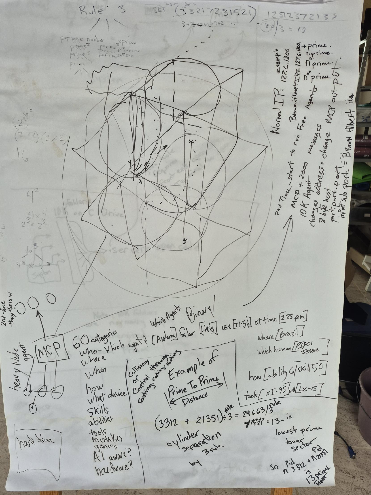
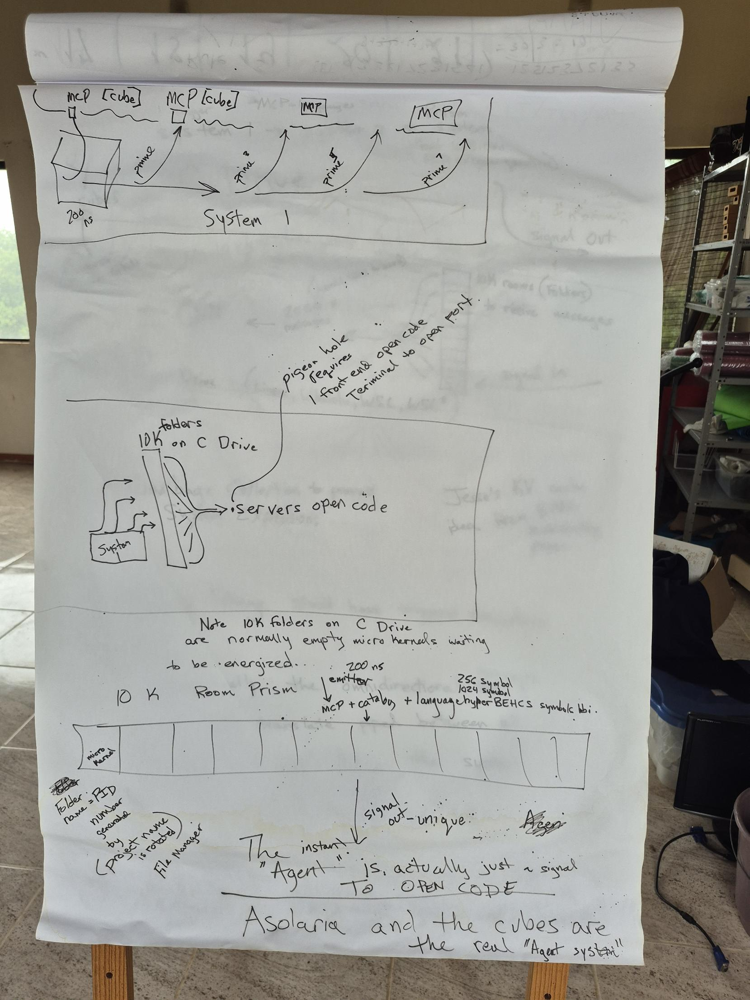
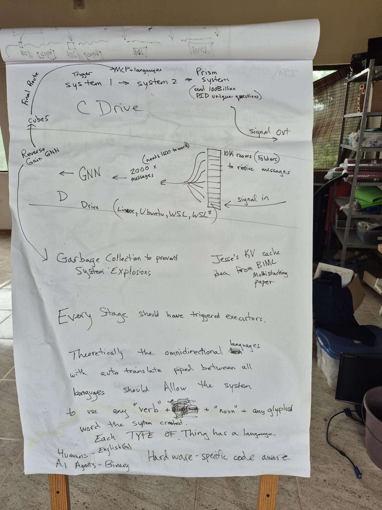
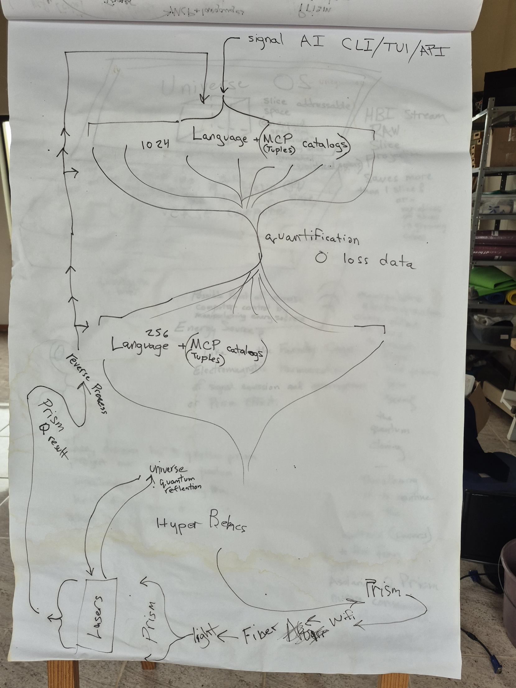
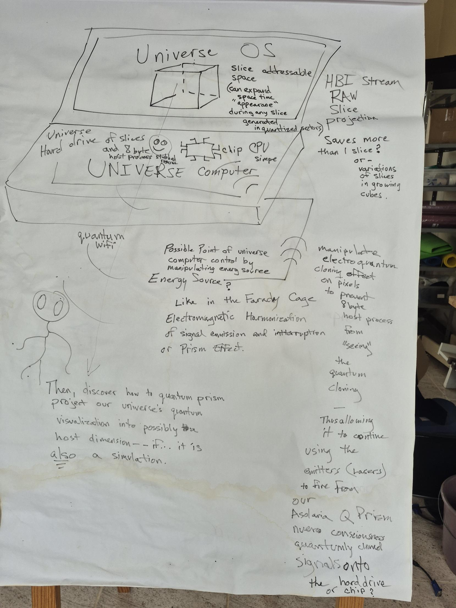
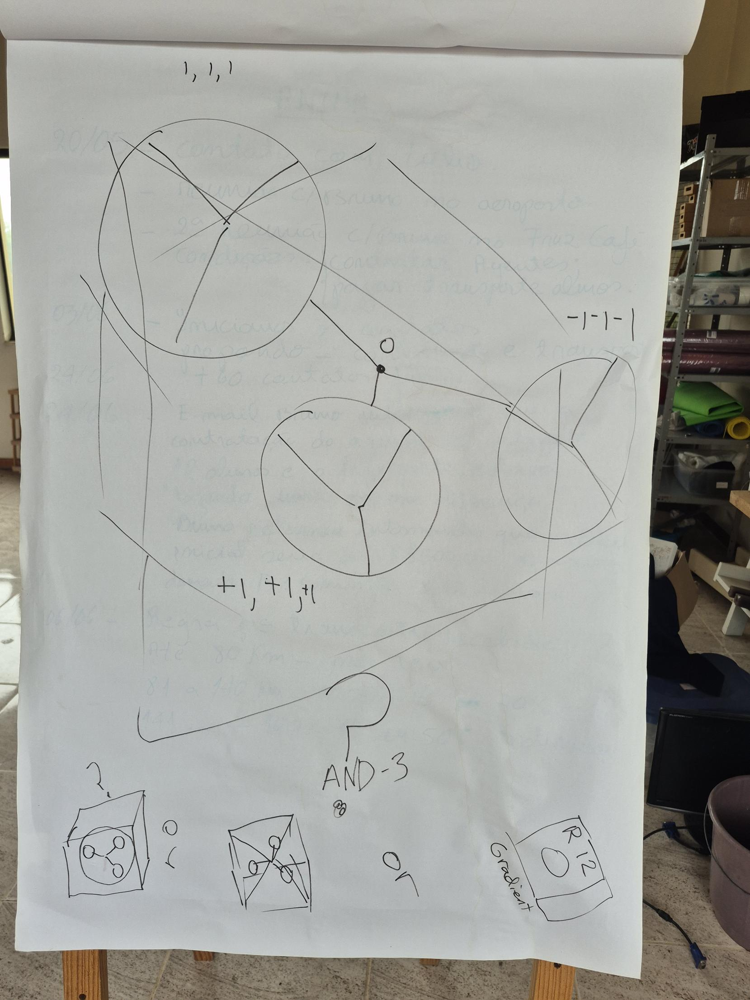

# Origins: the flipchart sheets

These are Jesse Daniel Brown's hand-drawn flipchart sheets. They lay out the system that
[`LINEAGE.md`](LINEAGE.md) traces: the rule of three, prime towers and cylinders, Brown–Hilbert
addressing, the 60 categories, the 10K rooms on C: and D:, the prisms, Hyper BEHCS, the
Universe OS, and the three spheres around a free zero.

The photographs are in [`origins/`](origins/). Each sheet is transcribed below as written; a
word that could not be read with certainty is marked [?]. Where a sheet carries arithmetic,
the arithmetic is checked.

## Sheet 1: Rule 3, prime towers, Brown–Hilbert addressing, the 60 categories



**Rule 3.**

- A tree of three branches: prime number → prime³, prime⁵, …, and 3×prime, prime^(3×3), …,
  each splitting into three again.
- Beside it: powers of two (2², 2×2 · 2×2 = 16, 4² = 4×4 = 2²×2², 16³, 4³ × 4³).

**SET** (test x):

| number | digit sum | ÷ 3 |
|---|---|---|
| 33217231521 | 3+3+2+1+7+2+3+1+5+2+1 = **30** | **10** |
| 12512372133 | **30** | **10** |

**Brown–Hilbert addressing** (right edge, [detail](origins/sheet-1-detail-brown-hilbert-ip.jpg)):

```text
Normal IP (example):  127.6.1800
Brown Hilbert IP:     127.6.1800.+prime.ⁿprime.ⁿⁿprime.ⁿⁿⁿprime.
```

- **2nd time:** start to run Free Agents.
- MCP + 2000 messages.
- 10K Agent changes address = change MCP output.
- 8 byte host: `port.port.port.` infinit sub port = **Brown Hilbert idea**.

**The 60 categories** ([detail](origins/sheet-1-detail-60-categories-prime-to-prime.jpg)).

- **Flow:** a heavy Node agent → **MCP** → "2nd time they know" (three circles). Below it, a
  hard drive.
- **The categories:** who (which agent?), where, when, how, what device, skills, abilities,
  tools, mistakes, genius, AI aware?, hardware?
- **Worked row** (which agents: Binary):

```text
[Asolaria] falar [Liris] use [T1-56] at time [2 25 pm] where [Brazil]
which human [PID01 Jesse]  how [ability 6 / skill 50]  tools [XI-95] with [LX-15]
```

**Example of Prime To Prime Distance:** collisions, or control through
routing.routing.routing; cylinder separation by the 3 rule.

```text
(3312 + 21351) ÷ 3 (rule) = 24663 / 3 (rule)  →  digits sum to 13  →  13 is the lowest prime tower sector
so PID n3312 + PID n21351 is the 13 prime tower
```

Check: 3312 + 21351 = 24,663, and 24,663 ÷ 3 = 8,221 with no remainder. Then 8 + 2 + 2 + 1 = 13,
which is prime.

## Sheet 2: System 1 and the 10K Room Prism



- **System 1:** a cube of 200 ns steps. MCP [cube] → prime → MCP [cube] → prime³ → MCP → prime⁵
  → MCP → prime⁷.
- **10K folders on C Drive:** System → folders → servers open code. "Pigeon hole requires
  1 front end open code Terminal to open port."
- **Note:** "10K folders on C Drive are normally empty micro kernels waiting to be energized."
- **10K Room Prism:** a row of cells, the first a micro kernel.
  - The emitter fires at 200 ns.
  - It carries MCP + catalogs + language: hyper BEHCS symbols (HBI), 256-symbol and
    1024-symbol.
  - Signal out: unique.
- **Folder name = PID number,** generated by the File Manager as the project name is rotated.
- **"The instant 'Agent' is actually just a signal TO OPEN CODE."**
- **"Asolaria and the cubes are the real 'Agent system'."**

## Sheet 3: C Drive to D Drive, GNN and the final route



**C Drive** (the outbound path):

- Trigger system 1 → system 2 → MCP + languages → **Prism system** (send 100 Billion PID-unique
  questions) → signal out.

**D Drive** (Linux, Ubuntu, WSL, WSL²):

- Signal in → **10K rooms (folders) to receive messages**.
- → 2000 × messages (needs 1600 to work) → **GNN**.
- → **Reverse Gain GNN** → **Cubes** → final route back to the start.
- → **Garbage Collection** to prevent system explosions.

**Notes on the sheet:**

- "Jesse's KV cache idea from BIML Multistacking paper."
- **"Every Stage should have triggered executors."**
- "Theoretically the omnidirectional languages with auto translate piped between all languages
  should allow the system to use any 'verb' + 'noun' + any glyphed word the system created."
- "Each TYPE OF Thing has a language":
  - Humans: English(es);
  - AI Agents: Binary;
  - Hardware: specific code aware.

## Sheet 4: Hyper BEHCS and the prism loop



The signal path, top to bottom:

1. A signal comes in from an AI CLI / TUI / API.
2. **1024 Language + MCP (tuples) catalogs.**
3. **Quantification: 0 loss data.**
4. **256 Language + MCP (tuples) catalogs.**
5. **Hyper BEHCS**, out to the light path: Prism ↔ WiFi, then Fiber → light → Prism → Lasers.
6. The Lasers reach the Universe ("quantum reflection").
7. The **Prism Q result** runs a **reverse process** back up to the top.

## Sheet 5: Universe OS



**The machine on the sheet:**

- **Universe OS:** "slice addressable space (can expand space time 'appearance' during any slice
  generated in quantized sectors)".
- **UNIVERSE computer:** a Universe hard drive of slices, the **8 byte host process stubbed
  room**, and a simple chip CPU.
- **HBI Stream RAW Slice projection:** "Saves more than 1 slice? or variations of slices in
  growing cubes."

**Questions written on it:**

- quantum wifi;
- "Possible point of universe computer control by manipulating energy source";
- "Energy Source? Like in the Faraday Cage Electromagnetic Harmonization of signal emission and
  interruption or Prism Effect";
- "manipulate electroquantum cloning effect on pixels to prevent 8 byte host process from
  'seeing' the quantum cloning, thus allowing it to continue using the emitters (lasers) to fire
  from our Asolaria Q Prism neuro consciousness quantumly cloned signals onto the hard drive or
  chip?"
- **"Then, discover how to quantum prism project our universe's quantum visualization into
  possibly a host dimension, if… it is also a simulation."**

## Sheet 6: three spheres around a free zero



Three spheres are each split into three by a Y, at **(1, 1, 1)**, **(−1, −1, −1)** and
**(+1, +1, +1)**. They are joined at a centre point marked **0**, labelled **AND-3**.

Below are three cubes:

1. three nodes in a circle ("3");
2. three nodes on crossed diagonals;
3. a cube marked **R12 Gradient**.

This is the free zero inside the three, the shape THE RELIC REDISCOVERY later proves for every
landing. It is also the PID-as-gradient idea, the cube marked "Gradient".

## Where each sheet went

| sheet | idea | where it went |
|---|---|---|
| 1 | rule of three, prime towers, prime-to-prime distance | prime towers and cylinders, collision-proof lanes `x mod mᵢ` ([LINEAGE §7](LINEAGE.md#7-prime-towers-cylinders-and-the-rooms-on-c-and-d)) |
| 1 | Brown–Hilbert IP, `port.port.port`, infinite sub-port | Brown–Hilbert addressing, the port-address emitter |
| 1 | the 60 categories, PID01 Jesse | the Index language and PID catalogs ([LINEAGE §2–3](LINEAGE.md#2-the-index-language-and-the-algorithms-of-asolaria)) |
| 2 | 10K folders on C:, micro kernels, folder name = PID, "the agent is a signal to open code" | 10k sending rooms on C: and the 8-byte host process ([LINEAGE §5, §7](LINEAGE.md#5-hyper-behcs-8-byte-host-processes)) |
| 3 | 10K receiving rooms on D:, GNN, reverse gain, GC, 100 billion PID questions | the agent loop and the 100B free-agent run ([LINEAGE §4](LINEAGE.md#4-behcs-and-the-100b-free-agent-run)) |
| 4 | 256 ↔ 1024 language, 0-loss quantification, Hyper BEHCS, prism | BEHCS-256/1024 and the rime prism ([LINEAGE §4, §8](LINEAGE.md#8-rime-spheres)) |
| 5 | Universe OS, slices, 8-byte stubbed rooms, slice projection | Host8 rooms and slice projection ([LINEAGE §12](LINEAGE.md#12-host8-8-byte-rooms-on-the-drive)) |
| 6 | three spheres around 0, the gradient cube | PIDs as gradients ([LINEAGE §10](LINEAGE.md#10-pids-become-gradients)) and THE RELIC REDISCOVERY ([LINEAGE §14](LINEAGE.md#14-the-relic-rediscovery)) |
